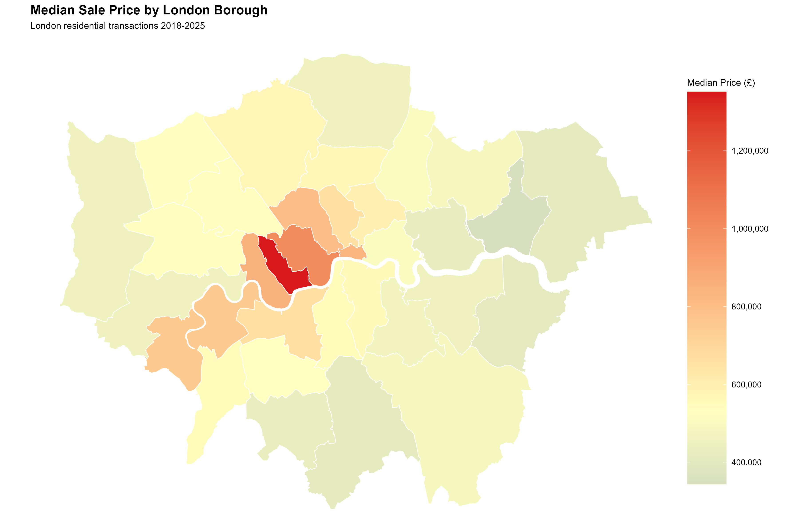
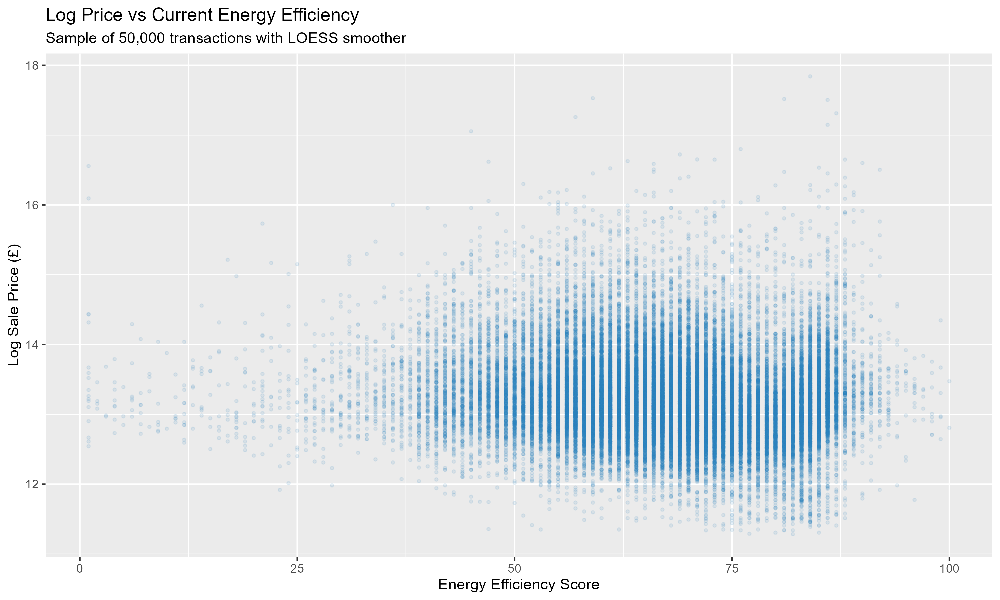
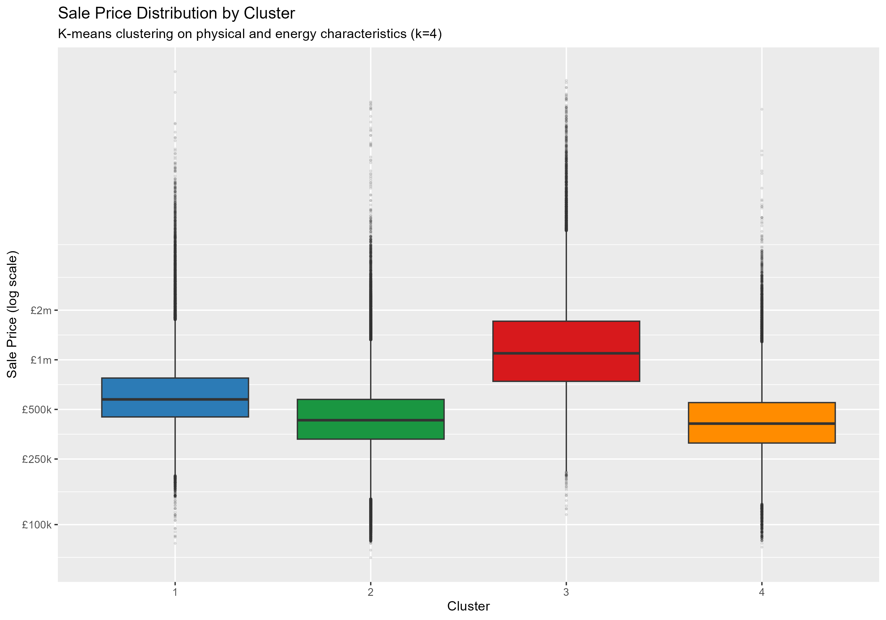

# London house prices and energy efficiency

An end-to-end R data project linking every London residential sale from 2018 to 2025
(HM Land Registry Price Paid Data) to the property's Energy Performance Certificate,
then enriching each sale with its location and distance to the nearest rail station,
to explore what drives London prices and where energy efficiency fits in.

## The hard part: joining two datasets with no shared key

Price Paid Data and EPC certificates have no common property ID, only free-text
addresses. The pipeline builds a record-linkage join:

- **Flats** are matched on postcode + a normalised flat identifier (SAON), parsing
  numeric, letter-only and alphanumeric forms such as `FLAT 2C`
- **Houses** are matched on postcode + a normalised house number/name (PAON)
- EPCs are deduplicated to the most recent certificate per address, so transactions
  are never multiplied by the join
- Match rates, duplicates and row counts are checked at every stage

Each sale is then geocoded through the ONS Postcode Directory, and its distance to
the nearest Tube, DLR, Overground or Elizabeth line station is computed with the
haversine formula, using station locations from the live TfL API.

## Pipeline

| Step | File | What it does |
|---|---|---|
| 1 | [`PPD_Data_Prep.Rmd`](analysis/PPD_Data_Prep.Rmd) | Load 2018–2025 Price Paid files, keep valid London residential sales, address parsing, ONSPD geocoding, TfL station distances, drop impossible locations |
| 2 | [`EPC_Data_Prep.Rmd`](analysis/EPC_Data_Prep.Rmd) | Load the 33 borough EPC extracts, select fields, build join keys, iterate on the match logic |
| 3 | [`EPC_PPD_Data_Prep.Rmd`](analysis/EPC_PPD_Data_Prep.Rmd) | Clean, consolidated version of the PPD × EPC merge with validation |
| 4 | [`Final_Data_Cleaning.Rmd`](analysis/Final_Data_Cleaning.Rmd) | Outliers, impossible values, category cleanup, missing-data audit, model-based imputation of habitable rooms from floor area and property type |
| 5 | [`EDA.Rmd`](analysis/EDA.Rmd) | Distributions, price against each driver, correlation heatmap, borough choropleths, k-means segmentation |

## Exploratory analysis

  
  

- Univariate distributions of price (raw and log), EPC score, floor area and station distance
- Price against EPC efficiency, property type, construction age, floor level, built form,
  station distance and district
- Correlation heatmap of the numeric features
- Choropleths of median price and median EPC efficiency by borough
- K-means segmentation on physical and energy characteristics, with k chosen from the
  elbow and silhouette plots (k = 4), and a PCA projection of the clusters

All 20 figures are in [`eda_plots/`](eda_plots).

## Data

The raw data is about 12 GB and is not redistributed here. To reproduce:

| Dataset | Source |
|---|---|
| Price Paid Data 2018–2025 (`pp-YYYY.csv`) | [HM Land Registry](https://www.gov.uk/government/statistical-data-sets/price-paid-data-downloads) |
| Domestic EPC certificates, London boroughs | [Energy Performance of Buildings Register](https://epc.opendatacommunities.org/) (free registration) |
| ONS Postcode Directory (Feb 2026) | [ONS Open Geography Portal](https://geoportal.statistics.gov.uk/) |
| London borough boundaries (`boroughs.geojson`) | [London Datastore](https://data.london.gov.uk/) |
| Station locations | TfL Unified API, fetched live by the notebook |

Layout: Price Paid files in `data_gov/`, the borough EPC extracts (`domestic-E09…` folders) in `epc/`,
and `ONSPD_FEB_2026_UK.csv` plus `boroughs.geojson` in the working directory. Then knit the R Markdown
files in pipeline order; each step writes the CSV the next one reads.

## Stack

R · tidyverse (dplyr, readr, tidyr, stringr, ggplot2, lubridate) · sf · geosphere · cluster · jsonlite
